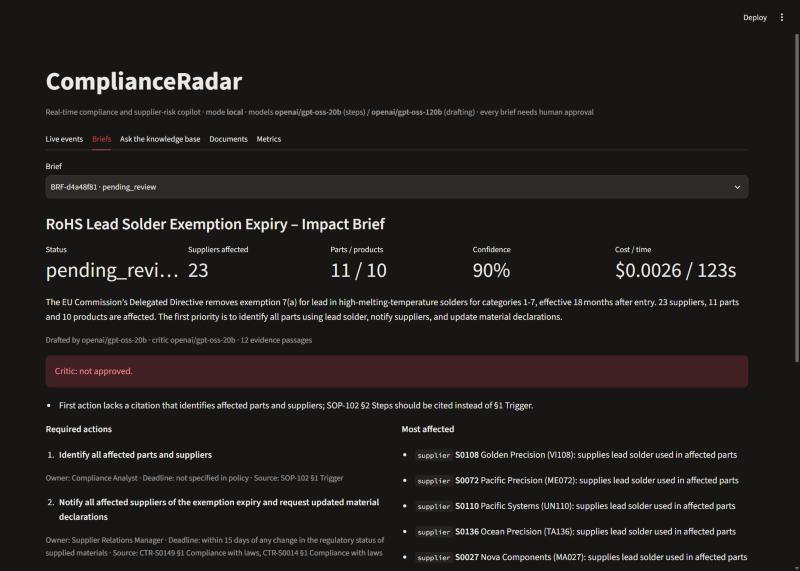
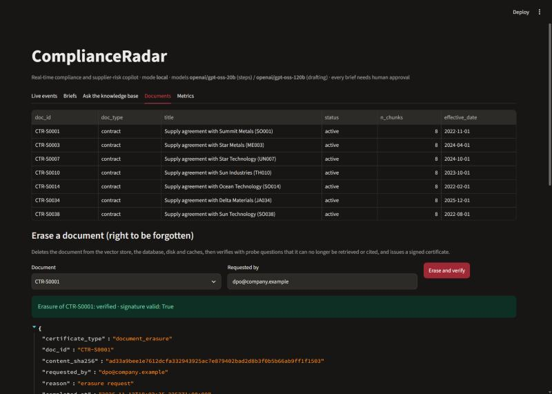

# ComplianceRadar

**A compliance and supplier-risk prototype for electronics manufacturers, built on synthetic company data.** When a user polls regulatory and news feeds, a stream worker classifies each item. For an event the user picks, a LangGraph pipeline finds the affected suppliers, parts and products with SQL, retrieves the relevant policy and contract passages, and drafts an impact brief with citations. Deterministic checks then remove invented ids and citations that are not in the retrieved evidence, an LLM critic reviews the draft, and a person approves it before any task is created.

 

Built with **LangGraph · LangChain · Qdrant (hybrid dense + BM25) · cross-encoder reranking · Redis Streams · PostgreSQL · FastAPI (SSE) · MCP · LoRA (PEFT) · Docker Compose · GitHub Actions**. Runs offline on a laptop with no keys (`RADAR_MODE=local`, mock LLM); the same code runs against real services and real models.

> **How this version came about.** An AI coding assistant built the first version. A second AI (Codex) audited commit `af9dd6b` and found 47 grouped issues. Among them: the LLM classifier tier never ran in live ingestion; erased documents came back on re-index; retrieved passages skipped e-mail/phone masking; dates were masked as phone numbers; and a brief metric measured the final draft while being named "first try". I verified each finding against the code, fixed the ones that affect the results or the demo, and added a regression test for every fix. The original results are kept unchanged in [`artifacts/superseded_af9dd6b/`](artifacts/superseded_af9dd6b/README.md) with an explanation.
>
> A second audit of the repaired commit `a92c2bd` (14 Nov) found nine remaining issues. Fixed since, each with a regression test in `tests/test_reaudit_fixes.py`:
> - The training notebook used `warmup_ratio`, which transformers 5 rejects. It now pins the stack it was run with and was executed end to end on CPU as a smoke test.
> - E-mail/phone masking missed some outbound paths (classifier prompt, event JSON, citation headings, revision feedback). It is now applied once, on the final messages, wherever a model is called.
> - An invented policy or contract id could stay in a brief. Such entries are now removed and listed as open questions.
> - A long brief could be approved by a critic that never saw its last actions. The critic now gets every action in full, or the review counts as partial and blocks approval.
> - Running the brief evaluation reset the app's own state, which could undo an erasure. It now runs in its own namespace.
> - The cost budget did not stop retries inside one model step. It is now checked before every call.
> - Chat citations matched only the section number. They now need the exact heading.
> - Impact totals were capped at one page of results. They are now exact.
>
> A third, independent audit of `b91c1dc` reproduced the tests, the retrieval scores and the LoRA adapter's 42/52 on CPU, and found smaller gaps, fixed with tests in `tests/test_independent_audit_fixes.py` (89 tests in total). The critic could still be shown a shortened action while the review was marked complete. A phone number followed by a date swallowed the date and part of a regulation number. Real RSS dates sorted alphabetically. An unresolved classification was silently routed like a confident one; it now goes to a visible "triage" status. MCP results were not masked, and the erasure certificate's wording claimed an inventory of tasks and checkpoints it does not contain.
>
> What is still open is listed under [Limitations](#limitations).

## The problem

A manufacturer with thousands of suppliers has to react to a steady stream of changes: a PFAS restriction, a RoHS exemption expiring, a new SVHC on the REACH Candidate List, a supplier added to the US Entity List, a factory fire. Today someone reads the notice, searches policies and contracts, queries the supplier master and BOMs, and writes an assessment.

## What it does

```
 feeds (EUR-Lex, ECHA, Federal Register, news, replay fixture)
        │ published when a user presses Poll (UI) or calls POST /ingest/poll; no scheduler
        ▼
   Redis Stream  ──►  worker: dedupe (id + MinHash LSH) · language · classify topic (rules → LoRA → LLM)
                              │ stored in SQL; a person picks an event to brief
                              ▼
   LangGraph pipeline (SQLite/Postgres checkpoints)
   triage ─► decompose ─► research ×N in parallel ─► map impact (SQL) ─► draft ─► verify + critic ─┬─► HUMAN REVIEW ─► publish tasks
              (cheap model)   (hybrid search + rerank)   suppliers·parts·products (strong model)  ▲        │   (interrupt / resume)
                                                                                                └ revise ┘
   Also: streaming chat over the knowledge base with citation-id checks · document erasure from retrieval with recorded checks · MCP server
```



## Results

Every number below comes from a file in `artifacts/`, produced by a script in `evaluation/`. All evaluations are small and use synthetic company records.

### Retrieval: does hybrid search and reranking earn its keep?

`artifacts/retrieval_eval.json`: 70 English questions written against the synthetic documents (301 chunks). *Direct* questions reuse the documents' vocabulary. *Paraphrased* questions avoid it ("forever chemicals" for PFAS, "blacklisted vendor" for Entity List).

| Method | Direct hit@1 (n=45) | Paraphrased hit@1 (n=25) | Paraphrased hit@5 | Paraphrased MRR | Paraphrased p50 latency |
|---|---|---|---|---|---|
| Dense (bge-small) | 0.98 | 0.64 | 0.76 | 0.69 | 12 ms |
| Sparse (BM25) | 0.96 | 0.40 | 0.60 | 0.47 | 16 ms |
| Hybrid (RRF fusion) | 1.00 | 0.52 | **0.84** | 0.65 | 17 ms |
| **Hybrid + cross-encoder rerank** | 1.00 | **0.76** | **0.84** | **0.79** | 429 ms |

How to read it: on direct questions every method works, which is why the paraphrased set exists. Fusion alone is *worse* than dense at hit@1 (0.52 vs 0.64) but finds more in the top 5. Reranking puts the right passage first (0.76), at about 25× the latency. Limits: this is an internal regression set authored against the generator, not held-out company traffic. A hit means the returned section starts with the gold section number. Each mode's latency includes computing both dense and sparse query embeddings.

### Event classification: topic accuracy on 52 English headlines

`artifacts/classifier_eval.json`: 52 hand-written English headlines, 4 per topic, 13 topics. **Topic only**: jurisdiction and urgency are produced but not evaluated. Titles only.

| Configuration | Correct / 52 | Accuracy | Macro-F1 | LLM calls | LLM API cost |
|---|---|---|---|---|---|
| Keyword rules | 31 | 0.60 | 0.62 | 0 | $0 |
| LoRA encoder alone (xlm-roberta-base, 1.19M trained parameters) | 42 | 0.81 | 0.80 | 0 | $0 (38 ms per headline on CPU) |
| Rules → LoRA | 45 | 0.87 | 0.86 | 0 | $0 |
| Rules → LLM (gpt-oss-20b) | 48 | 0.92 | 0.92 | 24 | $0.00066 |
| **Rules → LoRA → LLM** | **49** | **0.94** | **0.94** | **5** | **$0.00014** |

How to read it: on its own, the fine-tuned encoder is weaker than the LLM tier. As a middle tier it decided the 19 headlines where its softmax score was ≥ 0.8, so 5 of 52 reached the LLM instead of 24: **79% fewer LLM calls with comparable accuracy on this set (49 vs 48 correct)**. One headline is not a meaningful difference, and 52 headlines say nothing about savings on live feeds. Keyword rules that fire with confidence ≥ 0.6 are final; one confident rule error (a battery headline labelled conflict minerals) never reaches the later tiers. A keyword with an unrelated sense does the same: "strike prices" in a finance headline is a confident supplier incident. The confidence values are per-tier heuristics, not calibrated probabilities. When no tier is confident and no later tier is available, the event is stored as unresolved (`raw.resolved = false`) instead of as a decision. Jurisdiction and urgency are produced but not scored; jurisdiction acronyms now need word boundaries ("Bisphenol" no longer reads as US BIS). Changing the acceptance rule itself would need a new frozen test set, because this one was used during development.

**Offline vs live.** These numbers come from `evaluation/classifier.py` at commit `af9dd6b`. In that commit, live ingestion ran rules only (or rules → LoRA): the worker, API and UI never passed the LLM callback. Since commit `c5adf9e` all of them build the LLM tier from the same function the evaluation uses (`classify.llm_callback`), and each stored event records which tier decided it. The live path has not been re-measured on this set. The LoRA tier is optional (`RADAR_CLASSIFIER_MODEL`, needs `requirements-lora.txt`), and under the mock provider the LLM tier is off.

How the encoder was built: a strong LLM wrote 780 headlines (60 per topic; `scripts/make_classifier_dataset.py`). 702 were used for training and 78 held out for validation (best epoch chosen by validation macro-F1). LoRA (r=16, query/value, plus the classification head) was trained on a Colab T4 (`colab/train_classifier.ipynb`). That run recorded only its PEFT version (0.21.2). The notebook as published then used `warmup_ratio`, which transformers 5 rejects. It now uses `warmup_steps=0.1` (a 10% warmup in transformers 5), pins the stack it was tested with (transformers 5.22.2, peft 0.21.2, accelerate 1.15.0, datasets 5.2.0, scikit-learn 1.9.1), saves the label mapping next to the adapter, writes a run manifest (versions, seed, data and file hashes) and checks that the saved adapter reloads with the same labels and predictions. `scripts/smoke_test_notebook.py` executes every cell on CPU with 2 training steps; its record is `artifacts/notebook_smoke_2026-11-14.json`. That shows the cells run; it does not reproduce the 0.81 score, which comes from the original run. The adapter (4.7 MB, `models/event-classifier-lora/`) still needs the 279M-parameter base model at inference. The 52 test headlines were written by hand and never shown to the generator; no exact title overlap with training. How the 0.8 threshold was chosen was not recorded. The base model is multilingual, but no Chinese headline was in training or test, so multilingual accuracy is unmeasured.

### Impact briefs

`evaluation/briefs.py` runs the pipeline on the replay events and compares against truth written by hand in that file. Each column is exactly this check:

- **impact ids exact**: the brief's full supplier id set equals the truth set.
- **policy cited**: the governing policy is among the citations. This checks presence, not support.
- **first draft, no removals**: on the *first* draft, the verifier removed nothing (no invented id, no citation outside the evidence). Only that: a first draft can pass and still have a wrong count or a corrected name. Files from before 14 Nov call this `grounded_first_try`.
- **structural ok**: in the final brief, every action has a valid citation and the summary's totals equal SQL.
- **critic approved**: the LLM critic's own verdict.

Not scored: whether quotes are verbatim, whether cited passages entail the actions, obligation direction, deadlines.

**Real models after the fixes**: `artifacts/brief_eval_env_sample3.json`. gpt-oss-20b for decomposition, gpt-oss-120b for drafting and critique (Groq free tier). This is the **first 3 matching replay events** (PFAS, RoHS, REACH), not a random sample, run on the code of commit `c5adf9e`.

| Check | Result (n = 3) |
|---|---|
| Impact ids exact (full supplier id set equals truth) | 3 / 3 (54, 23 and 18 suppliers) |
| Governing policy cited | 3 / 3 |
| First draft needed no removals (no invented id or citation; not "correct") | 3 / 3 |
| Every action carries a valid citation | 3 / 3 |
| Structural checks pass on the final brief | 2 / 3 (see below) |
| LLM critic approved the final brief | 1 / 3 |
| Briefs that went through the one allowed revision | 3 / 3 |
| Fallback briefs | 0 |
| Estimated cost per brief / median time | $0.0050 / 152 s |

What the two non-approved briefs show:
- **RoHS.** The final draft had an action claiming a 15-day breach-notice duty for all suppliers. The cited contract clauses only require notification, and only bind two suppliers. Every citation existed, so the deterministic checks passed; the critic caught it.
- **REACH.** The summary said "8 tier‑1 suppliers"; SQL says 11. The critic caught it. The verifier also failed this brief, but for the wrong reason: "tier‑1" was written with a non-breaking hyphen, which the count check read as "1 suppliers", so it missed the real error. Fixed in commit `50128cc` with a regression test. This run predates that fix.

Both briefs reached the human reviewer flagged, not approved: that is the intended path. They also show that valid citations do not guarantee a correct claim. The PFAS first draft passed "no removals" but still had a wrong count, a corrected name and an uncited entry.

This 3-event run predates the second-audit fixes (ghost policy removal, complete critic input, exact totals, masking at the call boundary). Those change what the critic is shown, so its 1/3 approval is not a measurement of the current code. A rerun needs about a day of free-tier quota and has not been done.

The mock-model run (`artifacts/brief_eval_mock.json`, 11 events, rerun on the current code in its own state namespace) passes every check. That shows the pipeline and checks work end to end. It says nothing about model quality, because the mock critic always approves.

**History.** At commit `af9dd6b` a full 11-event real-model run reported supplier counts matching truth 11/11, governing policy cited 11/11, every action cited 11/11 and critic approval 7/11. Of the 4 rejections, two were real reasoning errors (a clause cited in the wrong direction; one supplier's contract used as evidence about another). Two were over-strict (asking for citations on facts restated from the event, or on database ids). The second kind led to the "SYSTEM OF RECORD vs EVIDENCE" prompt split; the first became the deterministic wrong-contract rule. That run used the old metric definitions, so it is kept in [`artifacts/superseded_af9dd6b/`](artifacts/superseded_af9dd6b/README.md) and not reported as a current result. A full 11-event rerun with the corrected metrics needs about one day of Groq free-tier quota and has not been done.

### Document erasure from retrieval



`DELETE /documents/{id}` (or the Documents tab) works in this order:

1. Writes an erasure **tombstone** first. Every ingest and rebuild path respects it, so ordinary re-indexing cannot bring the document back. Only an explicit demo reset (`python -m radar.data.build --reset-erasures`, or `python -m evaluation.briefs --use-app-state`) clears it. The brief evaluation and the tests run in their own state folders, so they cannot restore a document the app erased.
2. Deletes the document's vector chunks and its local source copies (its `documents.json` entry and the Markdown file), and marks the SQL row deleted. The title stays as a record.
3. **Records checks**: zero chunks left; probe questions built from the document's own wording no longer retrieve it in dense, sparse or hybrid mode; answers to them no longer cite it; the tombstone exists; no local source copy remains.

The result is a JSON certificate in the audit log, HMAC-signed. Without `RADAR_SIGNING_KEY` it is signed with a public demo key and says so: that signature only shows the file was not accidentally altered, not who issued it. Tested: erase → re-ingest → rebuild leaves the document out, and only the explicit reset restores it.

What this is not: a proof that the content has no influence left. Briefs whose citations name the document are listed in the certificate (not redacted); tasks, graph checkpoints and other derived copies are neither listed nor removed. Browser chat history, backups and copies inside other containers are out of scope. No model in this repository was trained on the company documents, so no weights need unlearning.

## Design decisions

| Decision | Why |
|---|---|
| **SQL counts, LLM prose.** The model's output schema has no field for counts or the event id; the full supplier/part/product id lists are stored with each brief. | A wrong supplier count is the most damaging error a brief can make. The summary is still prose, so explicit totals in it ("23 suppliers") are checked against SQL. |
| **Deterministic verifier before the LLM critic**, with a fixed list of checks (listed in `radar/agent/graph.py`). Structural failures (uncited action, no valid citation, wrong total, a critic review that could not include every action) block automatic approval even if the critic approves. A policy or contract entry must be a document retrieved in that run, or it moves to the open questions. | Exact checks are free; the critic's opinion is advisory. Verifier status, critic opinion and human decision are shown separately in the UI. |
| **System-of-record vs evidence** in the prompts. | First real runs hid supplier ids because "everything needs a citation". Separating the two kinds of input fixed it. |
| **Function-calling structured output with retries and a labelled fallback brief.** | Strict JSON-schema mode rejected optional fields; hosted reasoning models occasionally answer in prose. A failed draft becomes a clearly labelled fallback built from SQL and evidence. |
| **LangGraph with `Send`, a revise loop and `interrupt`.** Checkpoints in SQLite (local) or Postgres. | Parallel research, a bounded critic loop, and a human decision that can arrive later. The checkpointer in use is recorded on each brief; if neither can be opened, the in-memory fallback is logged and recorded instead of hidden. |
| **One redaction policy** (`radar/privacy.py`), applied to the final outbound messages wherever a model is called: classifier prompt, decomposition, drafting, critic, chat. | E-mail addresses and phone numbers only; dates and regulation numbers are kept. Applied at the boundary, so a new prompt field cannot skip it. Originals stay in the database for the reviewer. |
| **Two runtime modes behind one interface** (embedded Qdrant + fakeredis + SQLite, or real services). | Anyone can run it in a minute; CI runs both, the second against real Qdrant, Redis and Postgres containers. |
| **Local embeddings, BM25 and reranker (ONNX).** | Company documents are not sent anywhere for retrieval; only selected passages reach the LLM, after masking. |
| **Retry policy that reads the provider's answer, plus model fallback; no silent mock.** | Per-minute limits are waited out; a daily quota sends the request to the smaller model, recorded on the brief. A real provider without a key now raises an error instead of quietly running the mock. A per-brief cost and time budget is checked before every model call, retries and fallback included. Cost is estimated from reported tokens, so one call can overshoot the cap; calls with unknown prices are counted as `unpriced_calls`. |
| **Mock chat model implementing the LangChain interface.** | 91 tests and the mock evaluation need no key, so prompt-format and schema bugs fail in CI. |

## Quick start

```bash
python -m venv .venv && .venv/Scripts/activate        # source .venv/bin/activate on Linux/macOS
pip install -r requirements.txt
make data index       # generate the demo company (200 suppliers, 715 parts, 20 products, 52 documents) and index it
make test             # 91 tests, offline
streamlit run ui/app.py
```

In the UI: **Live events → Poll feeds (replay) → Draft brief → Briefs → Approve**. Then try the chat, and erase a document under **Documents**. `python -m radar.data.build --reset-erasures` restores the full demo corpus.

Real models: copy `.env.example` to `.env`, set `RADAR_LLM_PROVIDER=openai_compatible` (Groq, OpenAI, Ollama, vLLM) or `anthropic` and the key. Set `RADAR_SIGNING_KEY` if certificates should be signed with a private key. Real services: `docker compose up --build`. `.dockerignore` keeps `.env` and local state out of the image; secrets come from `env_file` at runtime.

Evaluations: `python -m evaluation.retrieval` · `python -m evaluation.classifier` · `python -m evaluation.briefs --provider env [--limit N]`. The brief evaluation resets the state it runs on, so by default it uses `.local-eval/briefs/`; `--use-app-state` runs it on (and resets) the app's own state. `--provider` must match the configured model. Results record the commit, a hash of any uncommitted diff and a hash of the input events.

Fine-tuned classifier tier (optional): `pip install torch --index-url https://download.pytorch.org/whl/cpu && pip install -r requirements-lora.txt` (pinned to the versions it was evaluated with), then set `RADAR_CLASSIFIER_MODEL=models/event-classifier-lora`. The plain Docker image does not include it.

MCP: `python -m radar.mcp_server` exposes search, supplier and BOM lookup, events and brief drafting to Claude Desktop / Claude Code. There is deliberately no tool to approve a brief. MCP results get the same e-mail/phone masking, since the client may pass them to a hosted model. Every tool declares all four MCP tool annotations: five are read-only, and `draft_impact_brief` is marked as writing a pending brief and calling the configured model provider (tested in `tests/test_mcp_annotations.py`).

## Repository map

```
radar/
  config.py · infra/        settings; Qdrant / Redis / SQL clients for both modes
  data/                     schemas (pydantic), synthetic company generator, build (tombstone-aware)
  db/                       SQLAlchemy tables: suppliers, parts, BOM, documents, events, briefs, tasks, audit log, erasures
  retrieval/                chunking with section citations, Qdrant hybrid store, reranker, ingestion (skips erased docs)
  ingest/                   feed pollers, Redis Streams worker, MinHash dedupe, tiered classifier (rules, LoRA, LLM)
  llm/                      model router, cost ledger (estimate), structured-call retries, mock model
  tools/                    schema-validated tools with injection redaction (permission labels are not enforced)
  agent/                    LangGraph pipeline, prompts, service (start / decide / read)
  privacy.py                e-mail/phone masking for provider-bound text
  chat.py · forget.py       streaming RAG chat with citation-id check · erasure with tombstone and recorded checks
  api.py · mcp_server.py    FastAPI (SSE) · MCP server
ui/app.py                   Streamlit: events, briefs, chat, documents, metrics
evaluation/                 retrieval, classifier and brief evaluations
artifacts/                  current results; superseded_af9dd6b/ keeps the pre-audit results
colab/train_classifier.ipynb   LoRA fine-tuning of the event classifier
models/event-classifier-lora/  the trained adapter and its label mapping
docs/                       DESIGN.md (the original plan + what was built), INTERVIEW_NOTES.md
tests/                      91 tests (tests/test_audit_fixes.py covers the audit fixes)
```

## Limitations

This is a local prototype on synthetic data, not a production service. Known gaps, deliberately left open:

- **No authentication.** Reviewer and requester names are typed text; anyone who can reach the API can read, approve, spend model budget or erase. Run it only on a trusted machine. Tool permission labels (read/write) are advertised but not enforced at dispatch.
- **User-triggered polling.** No scheduled poller, and nothing consumes `events:classified`; a person picks the event to brief.
- **Stream reliability.** Pending Redis messages are not reclaimed after a worker crash, one malformed message can stop a batch, and the SQL insert and the classified-stream publish are not atomic (no outbox). Deduplication keys on source URL/title, so a revised notice at the same URL is treated as a duplicate.
- **Verifier scope.** Quotes are not checked word for word, and whether a passage supports a claim (direction, deadline) is left to the LLM critic and the reviewer. A citation check proves the cited section exists in the evidence, not that it says what the brief claims. Chat citations must match a retrieved heading exactly, and an answer with no valid citation is flagged as unsupported, but the same limit applies. Impact is candidate impact from keywords: negations ("tantalum unaffected") are not understood, and only incident/export events are scoped by country, with a small English country list. Totals are exact for that keyword scope, not checked legal applicability.
- **Erasure under concurrency and failure.** An ingestion already running when a document is erased can write its chunks back. If the verification step fails after deletion, the tombstone stays `in_progress` with no certificate and a retry cannot complete it. Updating a document keeps chunks of sections that were removed. The Markdown chunker can drop a preamble, merge duplicate headings and exceed its size limit on long paragraphs. None of these affect the frozen synthetic corpus, but they matter before real documents are loaded.
- **Workflow.** The same event can be briefed twice, and task publication is not idempotent across a crash. If neither SQLite nor Postgres checkpointing can be opened, an in-memory saver is used: the brief records this, and the review cannot be resumed after a restart.
- **Tracing.** Langfuse is attached when keys are set but is not verified end to end; the `RADAR_LANGFUSE_*` settings are not passed to the SDK handler.
- **Evaluation size.** 52 headlines, 70 retrieval questions, 11 brief events (3 with real models after the fixes), all English, all against synthetic records. No Chinese evaluation, no RAGAS, no reviewer-time study.
- **Cost.** The ledger estimates from reported tokens and a price table; unknown models count as $0 and are reported as `unpriced_calls`. Not a bill.
- Company data (suppliers, BOMs, policies, contracts) is synthetic. Regulatory feeds are real public sources; tests use a replay fixture. Not legal advice.

## License

MIT, see [LICENSE](LICENSE).

## Author

Muskaan Mahadik · M.S. Intelligent Manufacturing Technology, Taiwan Tech · thesis on quantization and machine unlearning in LLMs · see also [Factory Copilot](https://github.com/Muskaanmahadik10/factory-copilot) and [DocChat](https://github.com/Muskaanmahadik10/docchat).
